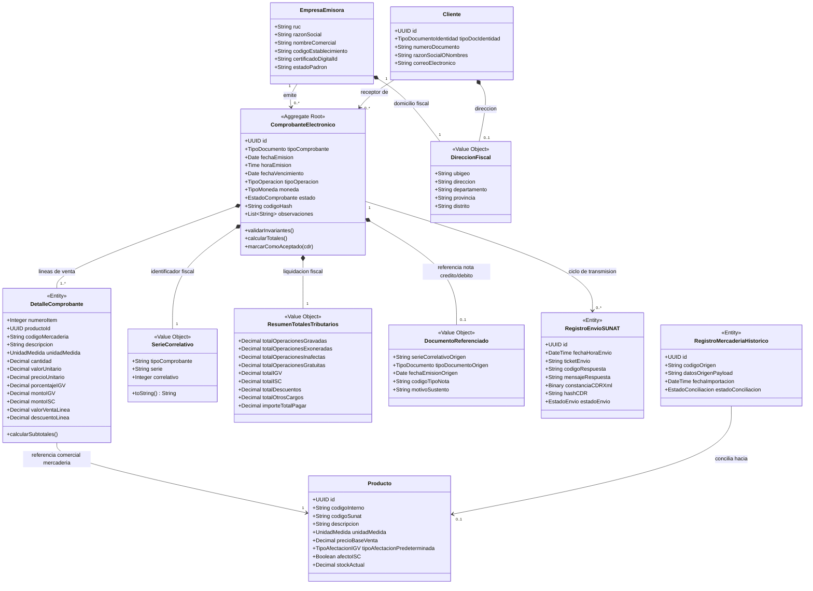
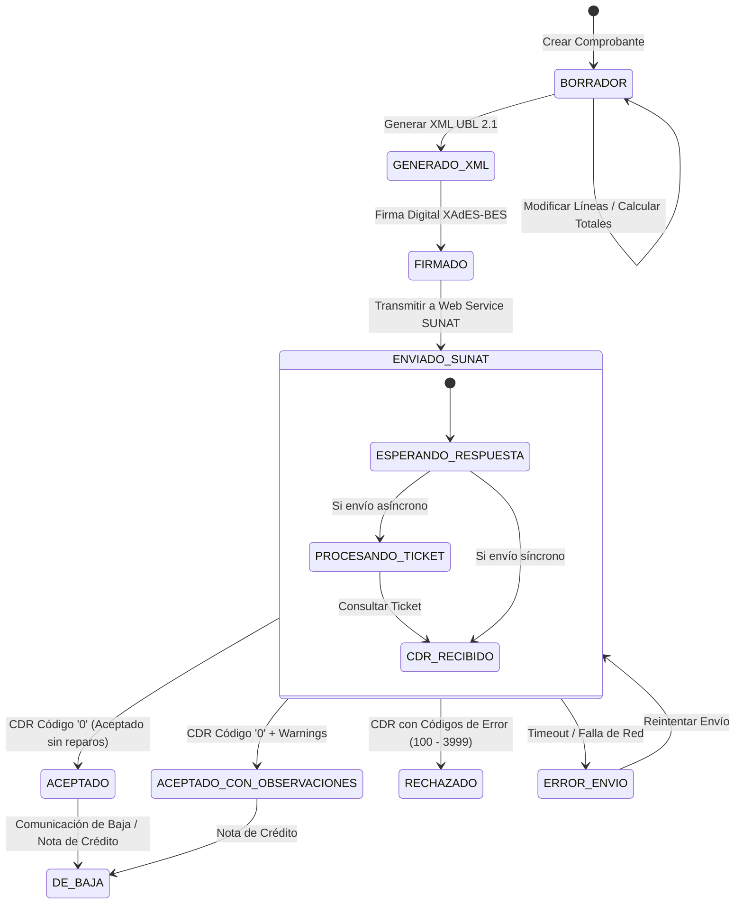

# Diagramas del Modelo de Dominio

- **Proyecto:** ABC Software Corp - Sistema de Comprobantes Electrónicos (SEE)
- **Documento:** Diagrama Conceptual y de Relaciones de Entidades del Dominio
- **Referencia Documental:** [`specs/domain/domain-model.md`](file:///d:/Projects/MedioCurso/MedioCurso/specs/domain/domain-model.md)

---

## 1. Diagrama Conceptual del Dominio y Agregados (Mermaid)

Este diagrama modela las fronteras del agregado principal `ComprobanteElectronico`, sus entidades satélite y los objetos de valor inmutables:

---

## 2. Diagrama de Estados del Ciclo de Vida del Comprobante

---

## 3. Justificación de Agrupación y Fronteras del Agregado

1. **Raíz del Agregado (`ComprobanteElectronico`):**
   - Garantiza el cuadre aritmético entre la sumatoria de las líneas de detalle (`DetalleComprobante`) y los totales tributarios (`ResumenTotalesTributarios`).
   - Ninguna línea de detalle puede existir de forma independiente sin su comprobante contenedor.
2. **Desacoplamiento del Inventario (`Producto`):**
   - La entidad `Producto` (mercadería de ABC Software Corp) vive fuera del agregado del comprobante. Al facturar, el detalle del comprobante congela el código, descripción, unidad de medida y precio histórico, protegiendo al documento fiscal contra modificaciones futuras del catálogo comercial.
3. **Aislamiento de la Infraestructura de Envío (`RegistroEnvioSUNAT`):**
   - La transmisión tributaria se desacopla del estado lógico del comprobante, permitiendo registrar múltiples intentos de envío, respuestas de contingencia, reintentos de red y preservación del archivo CDR.
