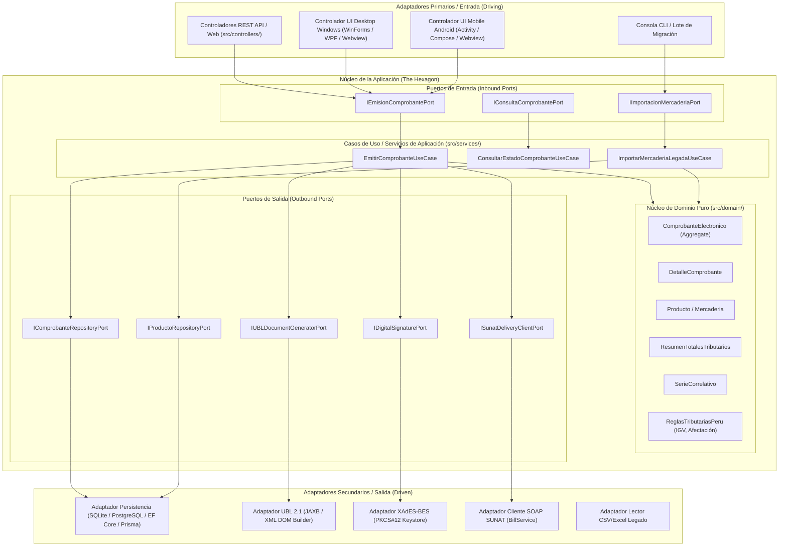

# Arquitectura del Sistema: Monolito MVC y Evolución a Arquitectura Hexagonal

- **Proyecto:** ABC Software Corp - Sistema de Gestión de Comprobantes Electrónicos (SEE)
- **Documento:** Especificación Arquitectónica Integrada (Fase 2)
- **Referencia de Identificador:** `ARC-001`
- **Ubicación:** `specs/architecture/mvc-and-hexagonal-architecture.md`

---

## 1. Visión General y Estilo Arquitectónico

El sistema de **ABC Software Corp** se diseña inicialmente como una **Arquitectura Monolítica Limpia basada en el patrón Modelo-Vista-Controlador (MVC)**. 

Se prioriza el monolito modular para:
1. Eliminar la sobrecarga operacional, latencias de red y complejidad transaccional de microservicios prematuros.
2. Centralizar la lógica tributaria peruana (cálculo de IGV, redondeo, reglas de validación y generación de XML UBL).
3. Establecer fronteras claras de desacoplamiento interno para que el software pueda operar en entornos de escritorio **Windows** y potencialmente en dispositivos **Android**, facilitando su empaquetado y distribución (`MSI` / `APK`).

---

## 2. Diagrama y Flujo de la Arquitectura Monolítica MVC (4.1)

```mermaid
flowchart TD
    subgraph Clientes ["Capa de Clientes (UI)"]
        UI_WIN["Cliente Escritorio Windows (MSI)"]
        UI_AND["Cliente Móvil / Tablet Android (APK / Web)"]
    end

    subgraph Presentacion ["Capa de Presentación (src/controllers & src/views)"]
        ROUTES["Enrutador de Peticiones (src/routes/)"]
        CTRL_CPE["ComprobantesController (src/controllers/)"]
        CTRL_MERC["MercaderiaController (src/controllers/)"]
        CTRL_CAT["CatalogosController (src/controllers/)"]
        VIEWS["Motor de Vistas / ViewModels (src/views/)"]
    end

    subgraph Aplicacion ["Capa de Aplicación / Servicios (src/services/)"]
        SVC_EMISION["FacturacionService<br>(Orquesta emisión, numeración y totales)"]
        SVC_UBL["UBLGenerationService<br>(Construye XML UBL 2.1)"]
        SVC_VALIDACION["ValidacionTributariaService<br>(Valida reglas SUNAT y esquemas)"]
        SVC_FIRMA["FirmaDigitalService<br>(Firma XAdES-BES en UBLExtensions)"]
        SVC_SUNAT["SunatDeliveryService<br>(Gestión de envíos y recepción CDR)"]
        SVC_IMPORT["MercaderiaImportService<br>(Conciliación de sistema legado)"]
    end

    subgraph Dominio ["Capa de Dominio Puro (src/domain/)"]
        DOM_CPE["ComprobanteElectronico (Aggregate Root)"]
        DOM_DET["DetalleComprobante"]
        DOM_TOTALES["ResumenTotalesTributarios (VO)"]
        DOM_SERIE["SerieCorrelativo (VO)"]
        DOM_PROD["Producto / Mercaderia"]
        DOM_EMISOR["EmpresaEmisora"]
        DOM_CLIENTE["Cliente / Receptor"]
    end

    subgraph Infraestructura ["Capa de Infraestructura y Adaptadores (src/infrastructure/)"]
        REPO_SQL["Repositorios SQL / Mapeadores (persistence/)<br>[ComprobanteRepo, ProductoRepo, EnvioRepo]"]
        ADAPT_XSD["Adaptador Validador XSD (tradeshift-ubl-xsd)"]
        ADAPT_CRYPTO["Adaptador Criptográfico PKCS#12 (external/)"]
        ADAPT_WS["Cliente Web Service SOAP / REST SUNAT (external/)"]
        ADAPT_LEGACY["Adaptador Ingesta Archivos Legados ABC"]
    end

    subgraph Almacenamiento ["Persistencia y Servicios Externos"]
        DB[(Base de Datos Local / Relacional)]
        SUNAT_WS["Servidores SUNAT (BETA / Producción)"]
    end

    %% Flujos
    UI_WIN --> ROUTES
    UI_AND --> ROUTES
    ROUTES --> CTRL_CPE
    ROUTES --> CTRL_MERC
    ROUTES --> CTRL_CAT

    CTRL_CPE --> SVC_EMISION
    CTRL_MERC --> SVC_IMPORT
    CTRL_CPE --> VIEWS
    VIEWS --> UI_WIN
    VIEWS --> UI_AND

    SVC_EMISION --> DOM_CPE
    SVC_EMISION --> SVC_UBL
    SVC_EMISION --> SVC_VALIDACION
    SVC_EMISION --> SVC_FIRMA
    SVC_EMISION --> SVC_SUNAT
    SVC_EMISION --> REPO_SQL

    SVC_UBL --> ADAPT_XSD
    SVC_UBL --> DOM_CPE
    SVC_FIRMA --> ADAPT_CRYPTO
    SVC_SUNAT --> ADAPT_WS
    SVC_IMPORT --> ADAPT_LEGACY
    SVC_IMPORT --> DOM_PROD

    REPO_SQL --> DB
    ADAPT_WS --> SUNAT_WS
```

### Flujo de Ejecución de una Solicitud de Emisión:
1. **Entrada:** El usuario ingresa los ítems de mercadería en la vista y presiona "Emitir Factura".
2. **Controlador:** `ComprobantesController` recibe el `CrearComprobanteRequestDTO`, valida formato sintáctico y delega a `FacturacionService`.
3. **Casos de Uso de Aplicación:**
   - Consulta el correlativo correspondiente y asegura la unicidad.
   - Instancia las entidades de `ComprobanteElectronico` y `DetalleComprobante` en el dominio.
   - El Dominio ejecuta las reglas invariantes de cálculo de bases imponibles e IGV (18%).
   - Invoca a `UBLGenerationService` para serializar la estructura a XML UBL 2.1.
   - Invoca a `FirmaDigitalService` para firmar criptográficamente el XML con el certificado digital.
   - Persiste el comprobante en la base de datos a través del repositorio.
   - Si la política de emisión es en línea, invoca a `SunatDeliveryService` para transmitir el archivo a SUNAT y recibir el CDR.
4. **Respuesta:** El controlador retorna el `ComprobanteResponseDTO` formateado por la vista hacia el cliente.

---

## 3. Diagrama y Estrategia de Evolución hacia Arquitectura Hexagonal (4.2)

La transición futura hacia Arquitectura Hexagonal (Puertos y Adaptadores) no requiere reescribir la lógica de negocio, ya que el diseño Monolítico Limpio aísla formalmente el Dominio y los Servicios de Aplicación.

### Componentes Independientes de Frameworks y Servicios Externos:
1. **El Núcleo de Dominio (`src/domain/`):** Totalmente libre de dependencias. Las clases de entidades y reglas tributarias no importan librerías HTTP, drivers de bases de datos ni generadores XML.
2. **Los Casos de Uso (`src/services/`):** Dependen únicamente de interfaces abstractas (puertos). Un cambio de motor de base de datos (ej. de SQLite a PostgreSQL) o de librería XML no altera ni una línea de la lógica de aplicación.

### 3.2. Proyección y Preparación para Microservicios (Escalabilidad Futura)
Para responder a la condición de la gerencia de estar preparados para escalar a microservicios cuando ABC Software Corp crezca, la estructura monolítica define tres **Contextos Delimitados (Bounded Contexts)** autónomos que podrán extraerse como servicios distribuidos sin rediseñar el negocio:
1. **Microservicio de Almacén y Kardex (RS 234-2006):** Encapsula el catálogo de mercadería, control de stock y movimientos de inventario.
2. **Microservicio de Facturación Electrónica UBL / SUNAT / OSE:** Encapsula la serialización XML UBL 2.1, motor de cálculo de impuestos (IGV, ISC Catálogo 08, ICBPER), firma digital y cliente de transmisión a SUNAT/OSE.
3. **Microservicio de Clientes y Padrón Fiscal:** Encapsula la validación y consulta de RUC/DNI y estado fiscal.
- **Comunicación en Microservicios:** La transición requerirá únicamente reemplazar los puertos en memoria (`Inbound/Outbound Ports`) por colas de mensajería asíncrona (RabbitMQ/Kafka) o llamadas gRPC/REST.

---

## 4. Evaluación de Restricciones de Plataforma y Distribución (4.3)

El requerimiento de soportar **Windows** (instalador `.msi`), **Android** (paquete `.apk`) y mantener una arquitectura monolítica limpia plantea implicaciones técnicas directas:

| Criterio | Enfoque 1: Monolito Autónomo por Plataforma (Fat Client) | Enfoque 2: Monolito Backend Centralizado + Clientes Ligeros | Enfoque 3: Aplicación Monolítica Híbrida / Multiplataforma |
|---|---|---|---|
| **Descripción** | La aplicación monolítica completa (MVC + SQLite local + Certificado local) corre de forma autónoma dentro del instalador MSI en Windows y APK en Android. | Un servidor monolítico central aloja la base de datos, el certificado digital y la API; los clientes MSI y APK son vistas/interfaces que consumen dicha API. | Un único codebase multiplataforma (ej. .NET MAUI, Flutter, o Electron/Capacitor) compila a MSI y APK compartiendo la lógica MVC local. |
| **Ventajas** | Operatividad 100% offline; el usuario puede emitir comprobantes en ruta sin internet y enviar a SUNAT cuando tenga conexión. | Certificado digital centralizado y seguro; numeración correlativa única sin riesgo de desincronización entre cajas o dispositivos. | Máxima reutilización de código de vistas y controladores entre Windows y Android. |
| **Riesgos / Trade-offs** | Riesgo de duplicidad de correlativos si dos dispositivos emiten con la misma serie; distribución del certificado digital privado a cada terminal. | Requiere servidor activo y conectividad permanente entre los terminales y el servidor central. | Dependencia de frameworks multiplataforma que pueden aumentar el tamaño del paquete instalable. |

### Decisión de Diseño Preliminar:
Se propone el **Patrón de Monolito Modular con Capacidad de API Local o Remota**:
- La arquitectura interna de `src/` se mantiene estrictamente dividida en Dominio, Servicios, Controladores e Infraestructura.
- Los controladores pueden ser invocados directamente por la interfaz local o mediante endpoints HTTP.
- Esta decisión queda registrada formalmente en el [ADR-0002](file:///d:/Projects/MedioCurso/MedioCurso/specs/architecture/decisions/0002-plataformas-distribucion-cliente.md).
